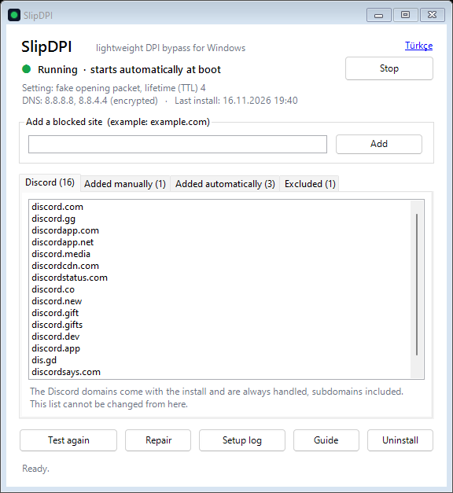
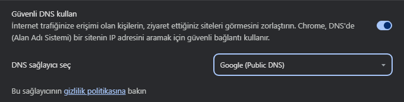

# SlipDPI

**Lightweight DPI bypass for Windows** · [Türkçe](README.md)

A small Windows program that gets past hostname-based (SNI) blocking in Türkiye without a VPN. Install it
once and it takes care of the rest: it runs in the background as a service and starts by itself every
time the computer starts. Speed and ping stay the same, and game traffic is never touched.

*The sites in the screenshot are sample data.*

## Why SlipDPI

- **Install and forget.** A single installer; during setup it tests your line and picks its own setting.
  After that there is nothing to open, start or keep running.
- **In the background, on every startup.** It runs as a Windows service and starts by itself when the
  computer starts. Nothing sits in the system tray and no window has to stay open.
- **Speed and ping stay the same.** No tunnel, VPN or proxy; traffic goes straight to its destination
  and your IP address does not change. Game traffic does not pass through the program, so ping in games
  does not go up.
- **It touches only what it has to.** Not all traffic: only the opening of connections to domains on its
  list. Everything else passes through unchanged.
- **It learns new blocked sites by itself.** If a site that is not on the list gets blocked, refreshing
  the page a few times is enough; the program adds it to its list.
- **Discord works out of the box.** Discord text and voice work right after installation.
- **Lightweight.** The installer is about 3 MB and the service uses about 8 MB of memory. It does not
  change the system-wide DNS setting.
- **English and Turkish.** The installer asks for the language; the window can switch it later.
- **One-click uninstall.** Uninstalling removes the service, the driver and every setting it made;
  nothing is left behind.

## Installation

**Requirements:** Windows 11 (64-bit) and administrator rights. If another DPI tool is running
(GoodbyeDPI, zapret, ByeDPI, SplitWire), close it first.

1. Download `SlipDPI-setup-<version>.exe` from the [Releases](../../releases) page and run it.
2. If Windows shows "Windows protected your PC", choose "More info" → "Run anyway". The installer is not
   signed; you can compare the file with `SHA256SUMS.txt` on the same page.
3. Pick the language, choose whether you want a Start menu and a desktop shortcut, then press "Install".
4. A console window opens and does the rest: it tests your line, picks a setting, installs the service
   and checks that it works. On first install this takes 2-3 minutes and blocked sites are unreachable
   meanwhile.

That is all. No restart is needed; blocked sites and Discord open.

Instead of the installer you can extract `SlipDPI-<version>.zip` to a folder and double-click
`install.cmd`.

**What it installs:** a service named `SlipDPI` and the WinDivert driver, the folder
`C:\Program Files\SlipDPI`, a DNS rule for the listed domains, and the Secure DNS setting in Chrome.

## Usage

In everyday use there is nothing to do. When you want to see the status or change something, the
"SlipDPI" shortcut (or `C:\Program Files\SlipDPI\panel.cmd` if you chose no shortcut) opens the control
window. Closing the window does not stop the program.

- **Stop / Start:** turns the program off or on. While stopped it does not start with
  Windows either.
- **Add / Remove:** adds a blocked site to the list or removes it.
- **Remove and exclude:** removes a site the program learned and keeps it from
  being added again. "Undo" reverses this.
- **Test again:** tests the line from scratch and picks the setting again. Use it if
  blocked sites stop opening.
- **Repair:** runs the setup steps again.
- **Setup log:** opens the log of the last setup.
- **Guide:** opens this guide.
- **Uninstall:** removes the program.

Hovering over a button shows what it does. "Test again" and "Repair" do not delete the lists. The link in the top right corner of the window switches between English and Turkish.

### A new blocked site

Usually you do not need to do anything: if a site that is not on the list is blocked three times within
a minute, the program adds it to its own list. In practice, refreshing the page two or three times is
enough, and it stays from then on. If that does not work, add it yourself with "Add".

Sites the program learned are shown on the "Added automatically" tab. That list is stored on your
computer as plain text and contains the names of the blocked sites you opened.

## What it touches and what it does not

The program works by domain name, not by application, and changes only connections to the domains on
its list.

| Traffic | What happens |
|---|---|
| Game server connections, in-game voice chat, every port other than 443 | Never reaches the program |
| HTTPS connections to sites and services not on the list (browser, game launchers, updates) | Looked at, passed through unchanged |
| Connections to listed domains, and the first packet of a Discord voice connection | Changed so the block is bypassed |

The list has three parts: the Discord domains that ship with the program, the sites you add, and the
blocked sites the program learns by itself. If a game or any other program connects to a listed domain,
that connection is handled too; which program opened it makes no difference.

The change is made only when a connection opens; download data is not touched.

## Troubleshooting

- **A new blocked site does not open:** refresh the page two or three times; if that fails, add it from
  the window. In a browser other than Chrome, check that Secure DNS is on.
- **Blocked sites stopped opening:** check in the window that the program is running, then use
  "Test again".
- **A site that used to work broke:** if it is on the "Added automatically" tab, use "Remove and exclude".
- **A site you removed still opens:** if the site is blocked, the program learns it again. Use
  "Remove and exclude" if you never want it handled.
- **Setup ended with an error:** try again with "Repair". If the service does not start, an antivirus
  (e.g. Kaspersky) may be blocking the WinDivert driver the program uses.
- **Discord is stuck on "Starting...":** quit Discord completely from the system tray and open it again.
- **Something broke and you do not know why:** press "Stop" in the window. If the problem continues,
  this program is not the cause.

## Uninstalling

"Uninstall" in the control window, or Settings → Apps → SlipDPI → Uninstall. If you installed from the zip,
run `uninstall.cmd`. The service, driver, DNS rule, Chrome setting, shortcuts and lists are removed; the
system returns to how it was before installation.

## Secure DNS in Chrome

The internet provider also returns wrong addresses for blocked sites. To get past that, the installer
turns on "Use secure DNS" in Chrome (provider: Google) by itself; you do not need to do anything.

This has two visible effects: Chrome's menu says "Your browser is managed by your organization", and
"Use secure DNS" in settings appears on and locked. Both go away when the program is uninstalled.

If you use another browser, turn the same setting on by hand and choose Google as the provider:

- **Edge, Brave:** Settings → Privacy and security → Security → "Use secure DNS"
- **Firefox:** Settings → Privacy & Security → "DNS over HTTPS"

## Good to know

- **It is not a VPN.** It does not hide your IP address, does not encrypt traffic, and does not get past
  blocks based on IP address.
- **Tested only on a Türk Telekom line.** The setup test is written to pick its own setting on any line,
  but it has not been verified on Superonline, Vodafone, TurkNet, Kablonet or mobile connections.
- **Measurements come from that one line.** There, ping, page load time, download speed and upload speed
  measured the same with the program on and off.
- **On Windows 10** the browser works, but apps such as Discord may not.
- If the provider changes how it blocks, the chosen setting may stop working; "Test again" looks
  for a new one.
- You use this program at your own responsibility.

## License

The program's own scripts are under the [MIT license](LICENSE). The bundled
[zapret](https://github.com/bol-van/zapret) engine, WinDivert and Cygwin files are under their own
licenses; details are in [THIRD-PARTY.md](THIRD-PARTY.md) (Turkish).
