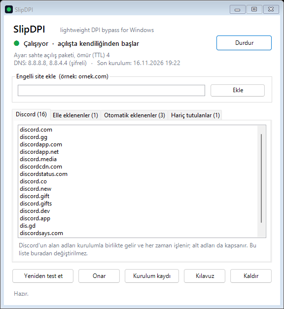
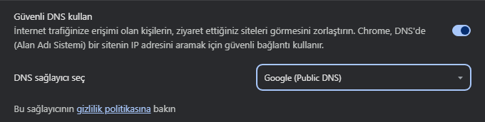

# SlipDPI

**Lightweight DPI bypass for Windows** · [English](README.en.md)

Türkiye'deki site adı (SNI) tabanlı erişim engellerini VPN kullanmadan aşan küçük bir Windows programı.
Bir kez kurarsın, gerisini kendi halleder: arka planda servis olarak çalışır ve bilgisayar her açıldığında
kendiliğinden başlar. Hız ve ping değişmez, oyun trafiğine hiç dokunmaz.

*Görüntüdeki siteler örnek veridir.*

## Neden SlipDPI

- **Kur ve unut.** Tek bir kurulum programı; kurulumda hattını kendisi test edip ayarını seçer. Sonrasında
  açman, başlatman ya da açık tutman gereken bir şey yoktur.
- **Arka planda, her açılışta.** Windows servisi olarak çalışır ve bilgisayar açılınca kendiliğinden
  başlar. Sistem tepsisinde bekleyen bir program ya da açık kalması gereken bir pencere yoktur.
- **Hız ve ping aynı kalır.** Tünel, VPN ya da proxy yoktur; trafik doğrudan hedefe gider ve IP adresin
  değişmez. Oyun trafiği programın içinden geçmez, oyunlarda ping artmaz.
- **Yalnızca gerekene dokunur.** Bütün trafiği değil, listedeki alan adlarına giden bağlantıların yalnızca
  açılışını değiştirir. Geri kalan her şey olduğu gibi geçer.
- **Yeni engelli siteleri kendi öğrenir.** Listede olmayan bir site engellenirse sayfayı birkaç kez
  yenilemek yeterlidir; program onu listesine ekler.
- **Discord hazır gelir.** Discord'un yazı ve ses bağlantıları kurulumla birlikte çalışır.
- **Hafif.** Kurulum programı yaklaşık 3 MB'tır, servis yaklaşık 8 MB bellek kullanır. Windows'un genel
  DNS ayarına dokunmaz.
- **Tek tıkla kaldırılır.** Kaldırınca servis, sürücü ve yaptığı bütün ayarlar geri alınır; geride bir
  şey kalmaz.

## Kurulum

**Gerekenler:** Windows 11 (64 bit) ve yönetici hakkı. Çalışan başka bir DPI aracı (GoodbyeDPI, zapret,
ByeDPI, SplitWire) varsa önce onu kapat.

1. [Releases](../../releases) sayfasından `SlipDPI-setup-<sürüm>.exe` dosyasını indirip çalıştır.
2. Windows "Kişisel bilgisayarınızı korudu" uyarısı verirse "Ek bilgi" → "Yine de çalıştır". Kurulum
   programı imzasızdır; dosyayı aynı sayfadaki `SHA256SUMS.txt` ile karşılaştırabilirsin.
3. Başlat menüsü ve masaüstü kısayolu isteyip istemediğini seç, "Kur"a bas.
4. Açılan siyah pencere gerisini yapar: hattını test edip uygun ayarı seçer, servisi kurar ve çalıştığını
   sınar. İlk kurulumda bu 2-3 dakika sürer ve o sırada engelli siteler kapalıdır.

Bu kadar. Bilgisayarı yeniden başlatmak gerekmez; engelli siteler ve Discord açılır.

Kurulum programı yerine `SlipDPI-<sürüm>.zip` dosyasını bir klasöre açıp `install.cmd` dosyasına çift
tıklayarak da kurabilirsin.

**Sisteme ne kurar:** `SlipDPI` adlı bir servis ve WinDivert sürücüsü, `C:\Program Files\SlipDPI`
klasörü, listedeki alan adları için bir DNS kuralı ve Chrome için Güvenli DNS ayarı.

## Kullanım

Günlük kullanımda bir şey yapman gerekmez. Durumu görmek ya da bir şeyi değiştirmek istediğinde "SlipDPI"
kısayolu (kısayol seçmediysen `C:\Program Files\SlipDPI\panel.cmd`) kontrol penceresini açar. Pencereyi
kapatman programı durdurmaz.

- **Durdur / Başlat:** programı kapatır ya da açar. Durdurulmuşsa açılışta da başlamaz.
- **Ekle / Çıkar:** engelli bir siteyi listeye ekler ya da listeden çıkarır.
- **Çıkar ve hariç tut:** programın kendi öğrendiği bir siteyi çıkarır ve bir daha eklememesini sağlar.
  "Geri al" bunu geri çevirir.
- **Yeniden test et:** hattı baştan test edip ayarı yeniden seçer. Engelli siteler yeniden kapanırsa kullan.
- **Onar:** kurulum adımlarını yeniden çalıştırır.
- **Kurulum kaydı:** son kurulumun kaydını açar.
- **Kılavuz:** bu belgeyi açar.
- **Kaldır:** programı kaldırır.

Düğmelerin üzerine gelince ne yaptıkları yazar. "Yeniden test et" ve "Onar" listeleri silmez.

### Yeni bir engelli site

Çoğu zaman bir şey yapman gerekmez: listede olmayan bir site bir dakika içinde üç kez engellenirse program
onu kendi listesine ekler. Pratikte sayfayı iki üç kez yenilemek yeterlidir, sonrası kalıcıdır. Olmazsa
pencereden "Ekle" ile kendin ekle.

Programın öğrendiği siteler "Otomatik eklenenler" sekmesinde görünür. Bu liste bilgisayarında düz metin
olarak durur ve açtığın engelli sitelerin adlarını içerir.

## Neye dokunur, neye dokunmaz

Program uygulamaya göre değil alan adına göre çalışır ve yalnızca listesindeki alan adlarına giden
bağlantıları değiştirir.

| Trafik | Ne olur |
|---|---|
| Oyun sunucusu bağlantıları, oyun içi sesli sohbet, 443 dışındaki bütün portlar | Programa hiç uğramaz |
| Listede olmayan sitelere ve servislere giden HTTPS bağlantıları (tarayıcı, oyun başlatıcıları, güncellemeler) | Bakılır, değiştirilmeden geçer |
| Listedeki alan adlarına giden bağlantılar ve Discord ses bağlantısının ilk paketi | Engeli aşacak şekilde değiştirilir |

Liste üç parçadır: kurulumla gelen Discord alan adları, senin eklediklerin ve programın kendi öğrendiği
engelli siteler. Bir oyun ya da başka bir program listedeki bir alan adına bağlanırsa o bağlantı da
işlenir; hangi programın açtığı fark etmez.

Değişiklik yalnızca bağlantının açılışında yapılır; indirme yönündeki veriye dokunulmaz.

## Sorun giderme

- **Yeni bir engelli site açılmıyor:** sayfayı iki üç kez yenile; olmuyorsa pencereden elle ekle. Chrome
  dışında bir tarayıcıdaysan Güvenli DNS'in açık olduğuna bak.
- **Engelli siteler yeniden kapandı:** pencerede programın çalıştığına bak, sonra "Yeniden test et".
- **Eskiden açılan bir site bozuldu:** "Otomatik eklenenler" sekmesinde varsa "Çıkar ve hariç tut".
- **Listeden çıkardığın site hâlâ açılıyor:** site engelliyse program onu yeniden öğrenir. Hiç işlenmesin
  istiyorsan "Çıkar ve hariç tut".
- **Kurulum sonunda hata yazdı:** "Onar" ile yeniden dene. Servis başlamıyorsa antivirüs (ör. Kaspersky)
  programın kullandığı WinDivert sürücüsünü engelliyor olabilir.
- **Discord "Starting..." ekranında kalıyor:** sistem tepsisinden Discord'dan tamamen çıkıp yeniden aç.
- **Bir şey bozuldu ve nedenini bilmiyorsun:** pencereden "Durdur". Sorun sürüyorsa bu programdan
  kaynaklanmıyordur.

## Kaldırma

Kontrol penceresindeki "Kaldır" düğmesi ya da Ayarlar → Uygulamalar → SlipDPI → Kaldır. Zip ile kurduysan
`uninstall.cmd`. Servis, sürücü, DNS kuralı, Chrome ayarı, kısayollar ve listeler silinir; sistem
kurulumdan önceki haline döner.

## Chrome'da Güvenli DNS

İnternet sağlayıcı engelli sitelerin adresini de yanlış bildirir. Bunu aşmak için kurulum Chrome'da
"Güvenli DNS kullan" ayarını (sağlayıcı: Google) kendisi açar; elle bir şey yapman gerekmez.

Bunun görünür iki sonucu var: Chrome menüsünde "Tarayıcınız kuruluşunuz tarafından yönetiliyor" yazar ve
ayarlardaki "Güvenli DNS kullan" seçeneği açık ve kilitli görünür. İkisi de program kaldırılınca gider.

Başka bir tarayıcı kullanıyorsan aynı ayarı elle aç ve sağlayıcı olarak Google'ı seç:

- **Edge, Brave:** Ayarlar → Gizlilik ve güvenlik → Güvenlik → "Güvenli DNS kullan"
- **Firefox:** Ayarlar → Gizlilik ve Güvenlik → "HTTPS üzerinden DNS"

## Bilmen gerekenler

- **VPN değildir.** IP adresini gizlemez, trafiği şifrelemez, IP adresine göre yapılan engelleri aşmaz.
- **Yalnızca Türk Telekom hattında denendi.** Kurulumdaki test her hatta kendi ayarını seçecek şekilde
  yazıldı, ama Superonline, Vodafone, TurkNet, Kablonet ve mobil hatlarda çalıştığı doğrulanmadı.
- **Ölçümler tek hattandır.** O hatta program açık ve kapalıyken ping, sayfa açılış süresi, indirme ve
  yükleme hızı aynı ölçüldü.
- **Windows 10'da** tarayıcı çalışır, Discord gibi uygulamalar açılmayabilir.
- İnternet sağlayıcı engelleme yöntemini değiştirirse seçilen ayar çalışmayabilir; "Yeniden test et"
  yeni ayarı arar.
- Bu programı kullanmanın sorumluluğu kullanana aittir.

## Lisans

Programın kendi betikleri [MIT lisansı](LICENSE) altındadır. İçindeki [zapret](https://github.com/bol-van/zapret)
motoru, WinDivert ve Cygwin dosyaları kendi lisanslarına tabidir; ayrıntılar
[THIRD-PARTY.md](THIRD-PARTY.md) dosyasındadır.
